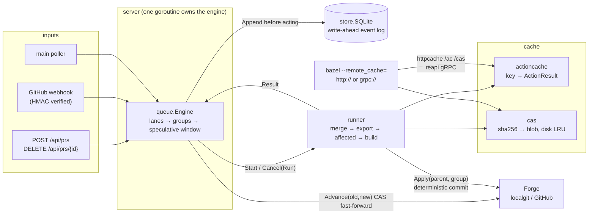

# Architecture



## The engine's data model

```
lane 1: [g1: #4] [g2: #7 #8] [g3: #9]  ...      ← groups; each merges as ONE commit
          run ✓       run ✗(suspect)  run …     ← first Depth non-suspect groups have runs
lane 2: [g4: #5] ...                            ← disjoint affected targets
waiting: #12                                    ← overlaps two lanes; placed when one drains
```

A run for group *gi* asks CI to test `main + g0 + … + gi`, leaving out
groups that are suspected bad. CI reports the tested commit and its parent.

| event | rule |
|---|---|
| head group passed and `parent == main` | write `merge_intent`, `Advance(main, commit)`, write `merged`, pop the head. Reset runs in this lane that did not include it. Mark every other lane stale. |
| head group failed (after the flaky retry) | 1 PR: eject it. More than 1: split it into two sealed halves at the head (bisection). Reset runs that included it. |
| non-head group failed (`SkipSuspects`) | mark it suspect and rebuild the groups behind it without it |
| a group is removed (eject, bisect, update, remove) | reset every run that included it. This includes suspects whose failure evidence contained it. |
| `main` moved for reasons outside the lane | running runs are left to finish but marked stale (their actions still reach the cache). Finished results are dropped and the groups are re-tested. |
| infra error | back off exponentially, retry, and eject only after `MaxInfraRetries` |
| timeout | handled like a failure with test `<timeout>` |
| a PR leaves the queue | re-form lanes: groups with runs, bisection halves and groups in backoff stay put; every other PR is re-placed in queue order |

Only the first row can change `main`, and it requires `parent == main` plus a
compare-and-swap fast-forward. All the other rules exist to waste less CI.

## Crash safety

```
merge:     Append(merge_intent{commit,parent,items}) → Advance → Append(merged)
recovery:  replay log; for each merge_intent without merged:
             forge.Contains(commit) ? Append(merged) : forget it
           every non-terminal PR goes back to QUEUED and is re-tested
```

CI results are never persisted, so after a crash the queue can only re-test.
It can never merge on the strength of a result it lost.

## Why the cache matters to the queue

In the simulator, a target's cache key is the hash of its input state: the
history of PRs that touched its reverse-dependency closure. In the real build
tool it is the sha256 of the command, the allowlisted environment and the
input digests. Speculative runs `#1`, `#1+#2` and `#1+#2+#3` share every
target that only `#1` touched. A lane's re-verification after another lane
merges shares every target, because the lanes' targets are disjoint by
construction. Without the cache those are all full rebuilds; see the
cache-off tables in [results.md](results.md).
